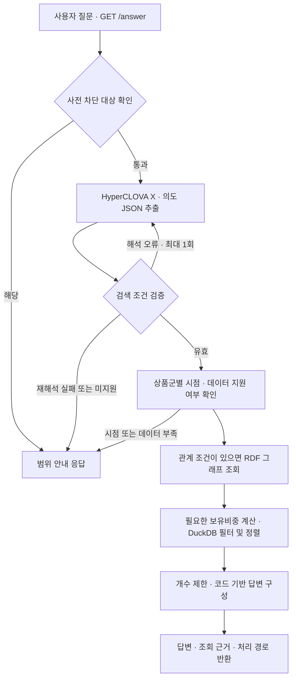
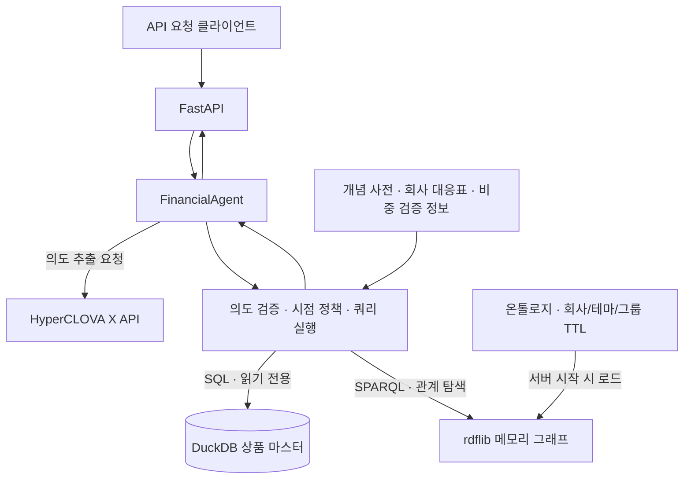

# 금융상품 질의응답 Agent

자연어로 금융상품의 조건과 회사 간 관계를 질문하면, 저장된 상품 정보와 지식그래프를 함께 조회해 답변하는 백엔드 서비스입니다. 국내 채권·국내 ETF·해외 ETF·공모펀드의 정보를 검색하고, 실행한 조회 조건과 결과를 답변 근거로 제공합니다.

- 프로젝트 형태: 개인 프로젝트
- 담당 역할: 데이터 적재·정제, 지식그래프 구축, 자연어 의도 추출, 조회 파이프라인 및 API 구현

## 프로젝트 개요

금융상품은 보수·만기·신용등급 같은 속성뿐 아니라 발행사·그룹·구성종목 관계까지 살펴봐야 원하는 상품을 찾을 수 있습니다. 이 프로젝트는 상품 속성을 저장한 DuckDB와 회사·테마·그룹 관계를 표현한 RDF 지식그래프를 결합해 이러한 검색을 지원합니다. HyperCLOVA X는 질문을 구조화된 검색 조건으로 변환하고, 실제 SQL·SPARQL 생성과 결과 표시는 코드가 담당합니다. 처리할 수 없는 조건이나 부족한 데이터는 안내하며, 조건을 임의로 생략한 결과를 정상 답변으로 제공하지 않도록 구성했습니다.

## 주요 기능

1. **조건 기반 상품 검색**: 신용등급·만기·총보수·기간별 수익률 등의 조건으로 상품을 조회하고 정렬합니다.
2. **회사·그룹·테마 관계 검색**: 특정 회사가 발행한 채권, 같은 그룹 계열사의 발행 채권, 특정 회사를 보유한 국내 ETF를 검색합니다.
3. **ETF 구성종목 및 비중 조회**: 국내 ETF의 저장된 회사별 보유내역을 조회하고, 지정한 회사들을 모두 보유한 ETF의 합산 비중 조건을 계산합니다. 테마 ETF 전체의 공통 구성종목은 비교 대상의 보유 데이터가 확인되는 경우에 계산합니다.
4. **복수 상품군 조회**: 채권과 ETF처럼 여러 상품군을 함께 요청할 수 있습니다. 개수를 지정하지 않으면 상품군별 최대 3개를 표시합니다.
5. **조회 시점 및 조건 검증**: 저장 데이터와 실시간·예측 요청을 구분하고, 실행한 SQL·조회 결과·처리 경로를 응답에 제공합니다.

### 질문 예시

- 국내 ETF 중 최근 1년 수익률이 높은 상품 5개 알려줘.
- 2027년에 만기가 돌아오는 채권 중 신용등급이 AA- 이상인 상품 알려줘.
- 신한은행과 같은 그룹 회사들이 발행한 채권과, 그 회사들을 담고 있는 ETF를 알려줘.
- 삼성전자와 SK하이닉스를 모두 보유한 국내 ETF 중 합산 비중이 30% 이하이고 총보수가 가장 낮은 상품 하나 알려줘.

결과는 저장된 데이터 범위에 따라 달라집니다. 일부 ETF의 구성종목 데이터가 없으면 전체 공통 구성종목을 확정하지 않으며, 조회되지 않은 상품에 해당 관계가 없다고 단정하지 않습니다. 채권 기준일은 실제 DB에서 읽고, 다른 데이터의 기준일은 확인되지 않은 경우 미확인으로 표시합니다.

## 시스템 아키텍처

### 전체 파이프라인



복수 상품군 요청은 상품군별로 검증·실행하므로, 지원 여부가 다르면 각 상품군의 결과와 안내를 함께 반환합니다.

### 백엔드 구성



## 기술 스택

| 분야 | 기술 스택 |
|:---:|---|
| **Backend** | Python, FastAPI, Uvicorn |
| **AI / 데이터 처리** | HyperCLOVA X, OpenAI 호환 SDK, pandas, openpyxl |
| **DB / 지식그래프** | DuckDB, rdflib, RDF/Turtle, SQL, SPARQL |
| **데이터 수집** | pykrx |
| **개발 / 검증** | Git, unittest, Dockerfile 기반 실행 환경 |

## 폴더 구조

```text
.
├── README.md
├── requirements.txt
├── Dockerfile
├── ontology.ttl                   # 지식그래프 스키마
├── src/
│   ├── config.py                  # 공통 경로 및 데이터 설정
│   ├── agent/
│   │   ├── app.py                 # FastAPI 엔드포인트
│   │   ├── agent_pipeline.py      # 전체 처리 및 답변 구성
│   │   ├── clova_client.py        # 자연어 의도 추출
│   │   ├── intent_validation.py   # 의도 JSON 검증
│   │   ├── temporal_policy.py     # 조회 시점 정책
│   │   ├── query_builder.py       # SQL·SPARQL 생성 및 관계 조회
│   │   ├── query_execution.py     # 상품군별 실행 및 비중 계산
│   │   └── prompts/intent_prompt.md
│   ├── ingest/                    # 원본 Excel → DuckDB 적재
│   ├── clean/                     # 위험등급·신용등급·날짜 등 정제
│   └── graph/                     # 회사 식별·관계 생성·비중 검증
├── data/
│   ├── collect_etf_pdf.py          # ETF 구성종목 수집
│   ├── raw/                       # 로컬 원본 데이터 · Git 제외
│   ├── processed/                 # DuckDB 및 중간 JSON · Git 제외
│   ├── graph/                     # 회사·테마·그룹 TTL 및 비중 검증 정보
│   └── dictionary/                # 개념 사전·회사 대응표·의도 스키마
├── docs/                          # 회사 식별 및 조회 정책 설명
├── tests/                         # 오프라인 단위·회귀 테스트
└── bench/                         # API 측정·결과 캐시·수동 채점 도구
```

회사·발행사 이름과 그룹 관리 방법은 [회사 식별 관리 안내](docs/company_identity.md), 조회 검증과 출력 정책은 [질문 검증과 조회 안내](docs/query_planning.md)를 참고하세요.

<details>
<summary>설치 및 실행 방법</summary>

### 사전 요구사항

- Python 3.12 권장
- CLOVA Studio API 키와 사용 가능한 모델
- `data/processed/findb.duckdb`에 적재·정제된 상품 테이블
- `data/graph/instances_company.ttl`, `instances_theme.ttl`, `instances_group.ttl`
- 저장소의 `ontology.ttl`, 개념 사전 및 프롬프트
- 비중 합산 기능은 원본과 대조된 `holdings_metadata.json` 및 그래프 원본 지문이 필요합니다.

원본 데이터와 DuckDB는 Git 추적 대상에서 제외되어 있어 저장소를 복제한 뒤 별도로 준비해야 합니다. 원본을 이용한 데이터 구축 명령은 아래 순서를 따릅니다. 기존 산출물을 교체하므로 데이터 갱신 시 실행합니다.

```powershell
python -m src.ingest.load_excel
python -m src.clean.build_clean
python -m src.graph.build_company_nodes
python -m src.graph.build_ttl
python -m src.graph.build_group
python -m src.graph.extract_theme
python -m src.graph.verify_holdings
```

### 백엔드 실행

모든 명령은 프로젝트 루트에서 PowerShell로 실행합니다.

```powershell
python -m venv fin
.\fin\Scripts\python.exe -m pip install -r requirements.txt
```

프로젝트 루트에 `.env`를 작성한 뒤 서버를 실행합니다.

```powershell
.\fin\Scripts\python.exe -m uvicorn src.agent.app:app --host 127.0.0.1 --port 8000
```

- API 문서: http://127.0.0.1:8000/docs
- 서버 상태: http://127.0.0.1:8000/health
- 코드나 그래프 파일 변경 후에는 서버를 재시작합니다.

### 환경 변수 설정

```dotenv
# 필수: CLOVA Studio API 키
CLOVA_API_KEY=your_api_key_here

# 선택: 기본 모델과 API 엔드포인트
CLOVA_MODEL=HCX-005
CLOVA_BASE_URL=https://clovastudio.stream.ntruss.com/v1/openai
```

`AGENT_BASE`는 선택 설정이며, 기본값은 프로젝트 루트입니다. 다른 데이터 루트를 사용할 때는 서버 실행 전에 환경 변수로 지정하고, 해당 경로에 필요한 데이터·사전·온톨로지·프롬프트를 준비합니다.

ETF 구성종목을 직접 수집할 때만 `.env`에 `KRX_ID`, `KRX_PW`가 추가로 필요합니다. API 키와 비밀번호는 저장소에 포함하지 않습니다.

### API 사용

`GET /answer`에 `question`을 전달합니다. `question_id`는 선택 항목입니다.

```powershell
$params = @{ question_id = 'Q-001'; question = '국내 ETF 중 최근 1년 수익률이 높은 상품 5개 알려줘.' }
Invoke-RestMethod -Uri 'http://127.0.0.1:8000/answer' -Method Get -Body $params
```

| 응답 필드 | 설명 |
|---|---|
| `question_id` | 요청 식별자 |
| `question` | 질문 원문 |
| `retrieved_context` | 실행 SQL·조회 결과 등 답변 근거 |
| `think_trace` | 적용한 관계·필터·정렬 및 중단 사유에 대한 실행 요약 |
| `answer` | 조회 결과 또는 처리 불가 안내 |

### 테스트

```powershell
.\fin\Scripts\python.exe -m unittest discover -s tests -v
```

단위·회귀 테스트는 임시 데이터와 메모리 DB·그래프를 사용하며 CLOVA API를 호출하지 않습니다. `bench`의 서버 질의 도구는 실행 시 실제 API 호출 비용이 발생할 수 있습니다.

</details>
